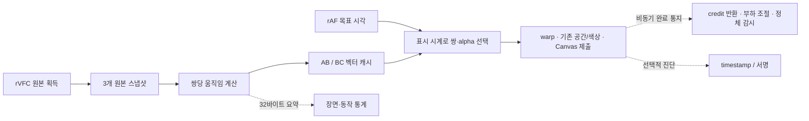

> 과거 첫 최적화 단계의 보존 기록입니다. 최종 안정화·원본 FPS 정책·잔여 문제는 [최종 보고서](REPORT.ko.md)를 기준으로 읽어 주세요.

# Clarity v1.2.1 — FPS 보간 병목 수정 및 검증

이 작업은 v1.2의 FPS 보간 경로를 수정했습니다. 새 사용자 기능은 추가하지 않았습니다. 동일 기기의 동결 v1.2 코드와 수정본을 비교했으며, 모든 성능 수치는 **Canvas 제출 FPS**입니다. 실제 모니터에 표시된 고유 프레임 수나 청각적 A/V 동기화 성공을 뜻하지 않습니다.

## 1. 발견한 병목

**확인된 사실: GPU 커널 계산 외에 CPU/GPU 왕복 대기와 시간축·프레임 쌍 선택이 출력을 제한했습니다.** RTX 4060 Ti라는 사양만으로 판단하지 않았습니다.

수정 전 256×144, 60→120 진단 측정에서 GPU 움직임 계산은 평균 0.515ms였지만 분석 요약 readback 완료 통지는 4.296ms, 매 출력의 서명 readback 대기는 2.102ms였습니다. render/present 오류 scope도 각각 평균 0.933/0.664ms를 기다렸습니다. 같은 `busy` 상태가 원본 획득·계산·출력을 직렬화해 출력 시도 1,225회 중 555회(45.3%)가 busy로 생략됐습니다. 이 구간의 rAF는 평균 7.055ms로 호출됐으므로 낮은 제출 FPS를 디스플레이 60Hz로 설명할 수 없습니다. 대기 값들은 중첩되는 구간이 있으므로 합산해 GPU 시간으로 보고하지 않습니다. [원시 계측](baseline-probe.json)

동기화만 제거한 중간 수정은 동일 60FPS 입력에서 일반 모드 54.26→113.40FPS로 개선됐지만, 24FPS에서는 1.27FPS로 실패했습니다. 1,225회 시도 중 1,212회에 유효한 쌍을 찾지 못했습니다. 최적화 뒤 `video.currentTime`과 rVFC 원본 프레임 표시 시점 사이의 위상 차이가 드러났고, 최신 두 장만 유지한 상태에서는 필요한 이전 쌍을 잃었습니다. `VideoFrame` 기본 timestamp와 rVFC mediaTime, 움직이는 사각형의 실제 위치를 함께 검사했으며 추출 프레임의 오표기는 발견하지 않았습니다. [중간 실패 측정](sync-probe.json), [프레임 시계 검사](frame-clock.json)

이후 표시 시계와 이전 쌍 캐시를 적용한 단계에서 60→120 일반 모드는 119.84FPS, 24→120 진단 모드는 119.66FPS를 제출했습니다. 그러나 24FPS의 표시 감시기가 정상적인 프레임 유지 시간을 과거 프레임으로 판단하는 문제가 남아 이를 별도로 수정했습니다. [단계별 측정](after-probe.json)

마지막으로 큰 입력의 60→100/120에서 제출률이 다시 낮아졌습니다. 블록 중심 한 픽셀만으로 정지 여부를 판단해 경계가 중심 사이를 움직이면 정지로 오분류했습니다. 2픽셀 이동으로 RGB 채널 912개가 바뀌는 8개 위치 중 v1.2는 2개를 정지로 판정했습니다. 수정 후에는 8개 이동 모두 동작, 8개 정지 모두 정지로 판정했습니다. 움직임 검색 결과의 confidence는 같았습니다. [분류 증거](static-classification.json)

Optical Flow 검색 자체가 핵심 병목이라는 증거는 없었습니다. 기존 저해상도 블록 검색·양방향 워핑·검색 단계·신뢰도 계산을 유지했습니다. 패치 차이는 이미 계산한 값을 재사용했고, 중심 텍스처 읽기 두 번을 제거했습니다. 대규모 신경망·새 보간 알고리즘은 도입하지 않았습니다.

v1.2에서도 flow 계산은 원본 획득에 연결되어 프레임 쌍당 한 번 수행됐습니다. 이를 매 rAF마다 재계산하던 버그로 설명하면 부정확합니다. 이번 변경은 그 계산 결과를 최근 두 쌍에 보존하고, 읽기 완료 대기가 다음 획득·출력을 막던 의존성을 제거한 것입니다.

기본 tier 1의 분석은 16:9 입력에서 최대 256×144, 블록 8×8, grid 32×18, 정/역방향 2개입니다. workgroup은 8×8이고 경계 밖 invocation은 반환합니다. 검색 반경 8에서 4픽셀 간격 후보 25개→5×5 정밀 후보 25개→서브픽셀 주변 4개와 초기 후보를 평가하며 각 패치는 4×4 표본입니다. 따라서 프레임 쌍당 약 2백만 텍스처 읽기 규모입니다. 낮은 tier는 패치·검색 범위를 줄이는 기존 경로를 유지합니다. 새 피라미드·검색 조기 종료·workgroup 변경은 품질 손실 없이 이득이 있다는 측정 근거가 없어 적용하지 않았습니다.

## 2. 수정한 코드

| 파일 | 핵심 변경 |
| --- | --- |
| `src/gpu/WebGPUEngine.ts` | 보간 warp→기존 공간 처리→Canvas 합성을 한 encoder에 제출. 매 프레임 서명·scope·fence를 foreground에서 기다리지 않음. 최대 3개 GPU 제출 credit, 완료 통지·오류·정체 감시는 비동기 유지 |
| `src/gpu/MotionEstimator.ts` | 원본 스냅샷 3개, 최근 두 쌍의 flow bank 유지. 원본 쌍당 한 번 계산한 벡터 재사용. 32바이트 분석 요약은 3슬롯 비동기 읽기 |
| `src/shaders/motion-flow.wgsl` | 중심 픽셀 대신 기존 zero-displacement 패치 오차로 동작/컷 차이 판정 |
| `src/shaders/motion-warp.wgsl` | CPU 분석 요약을 기다리지 않고 GPU 장면 전환 결과로 최신 원본 선택 |
| `src/temporal/PresentationClock.ts` | rVFC expectedDisplayTime으로 원본 표시 시계를 추정. 이전/최신 쌍 선택. 144Hz에서 75/100/120 목표의 누산형 출력 pacing |
| `src/temporal/InterpolationSession.ts` | 짧은 CPU 인코딩과 GPU 완료 대기 분리. 시계 불연속·추가 지연·전체 지연·제출 마감 분리, 정상 프레임 유지 허용, 폐기 사유 계측 |
| `src/content/VideoProcessor.ts` | 새 보간 제출 경로와 실제 표시 상태 연동, GPU 완료 지연을 비동기로 성능 감시에 반영, 정체 시 기존 WebGL2 복구 |
| `src/gpu/GpuTimer.ts`, `src/temporal/TemporalProfiler.ts` | 선택적 timestamp-query와 제한된 샘플 저장. 일반 모드는 query·서명 읽기 생략 |
| `src/adaptive/PerformanceMonitor.ts`, `src/adaptive/Resolution.ts`, `src/shared/types.ts` | 제출·완료 계측 분리, 스냅샷 한 장 추가에 맞춘 메모리 추정, 추가 진단 값 |
| `src/content/index.ts`, `src/popup/*` | 내부 진단 메시지, 지연 기준·서명 미수집 설명. 설정·메뉴 기능 추가 없음 |
| `src/harness/*`, `tests/*`, `scripts/*v121*` | 동결 기준 버전, 실제 GPU 픽셀·스케줄러·분리 벤치마크·YouTube 검증 |

원본 획득은 출력 완료를 기다리지 않습니다. 대기 입력은 최신 `VideoFrame` 하나로 제한하며 교체·종료 시 close합니다. GPU queue 순서로 동일 uniform/텍스처의 사용 순서를 보장하고, 필요한 쌍의 bank와 원본 크기를 제출 직전에 다시 확인합니다. 해상도 변경은 in-flight 작업이 없는 시점에 할당합니다. 사용 중 자원은 완료 통지 뒤 해제하며, 장치 종료 시 즉시 정리합니다. CPU 대기 제거가 자원 수명 검사를 제거한 것은 아닙니다.

적응형 조절은 기존 순서를 유지합니다. GPU queue 완료 통지 지연과 backpressure를 비동기로 반영하고 분석 품질·공간 처리·출력 빈도를 낮춥니다. 지속적으로 원본 FPS보다 낮으면 기존 10초 원본 FPS 공간·색상 보정 복구가 작동합니다. 완료 통지가 1.5초 이상 멈추면 감시기가 WebGL2 복구를 요청합니다. 일반 해상도·기존 공간 처리의 제한은 유지했고, 보간 메모리 예산만 스냅샷 증가에 맞춰 224→256MiB로 조정했습니다. 보간 끔은 기존 224MiB입니다.

### 시간 정책과 지연의 의미

기존 `video.currentTime − 보간 프레임 PTS <= 45ms`를 그대로 더 큰 숫자로 바꾸지 않았습니다. **정책의 기준 자체는 바뀌었으므로 전후 지연을 같은 의미로 읽으면 안 됩니다.**

- 출력 계획은 추정 원본 표시 시각보다 원본 한 프레임 간격 늦게 잡습니다. 24/30/60FPS의 의도된 추가 지연은 약 41.67/33.33/16.67ms입니다. 외삽하지 않습니다.
- 제출 직전 원본 표시 시계 대비 추가 지연 `−2…45ms`, 다음 화면 갱신까지의 CPU 제출 마감, `video.currentTime` 대비 총 시간차 100ms 상한을 각각 검사합니다.
- native 시계 오프셋이 비정상적으로 변하면 제출을 폐기하고 원본을 표시합니다. 탐색·재생 속도·루프에서는 시계를 다시 맞춥니다.
- 제출 사이 화면 유지는 목표 간격 + 화면 갱신 한 간격 + 1ms를 허용합니다. 따라서 **표시 중 모든 순간의 추가 지연이 45ms 이내라는 보장은 없습니다.**

원본 자체의 표시 지연 때문에 24FPS 총 시간차는 약 55ms였고, 브라우저 위상이 다른 테스트에서는 약 91ms도 기록됐습니다. 오디오를 늦추지는 않습니다. 이 시간 정책은 24FPS 표시 지속성과 지연 사이의 절충입니다. 60FPS 단계 시험에서는 총 시간차 최대 31.1ms로 기존 45ms 안에서도 약 120FPS가 나왔으므로, 모든 개선을 100ms 총 시간차 허용으로 얻은 것은 아닙니다. 실제 음성과 화면의 지각적 동기화는 검증하지 못했습니다.

## 3. 성능 개선 결과

최종 **45개 일반 조건 전체**, 5개 진단 조건, p50/p10/p01, 생성 수, 보정 표시 비율, 사유별 폐기 및 단계별 시간은 [성능표](PERFORMANCE.md), [CSV](comparison.csv)에 있습니다. 모든 미달·오류도 포함합니다. 원본은 [전](baseline-matrix.json), [최초 준비 실패 재시도](baseline-retry.json), [후](after-matrix.json)입니다. 출력 제출률이 목표의 98% 미만인 조건은 표에서 목표 미달로 표시합니다. 평균만으로 완벽한 프레임 pacing을 주장하지 않습니다.

중간 변경을 한 번씩 측정한 기록도 보존했습니다. 동기화 제거→시간축 수정→정지 오분류 수정의 순서입니다. 정지 오분류 수정 전 720p 60→100은 약 92FPS였고, 그 변경 하나를 적용한 진단 재측정은 100.06FPS였습니다. 720p 60→120은 해당 재측정에서 119.62FPS였습니다. [정지 판정 수정 전 전체 측정](after-before-static-fix.json), [수정 직후 재측정](after-static.json)

분리 벤치마크 A/B/C/D는 [ablation.json](ablation.json)과 최종 측정 요약을 참조하세요. A는 보간·확대·색상 변화 없는 원본 FPS GPU 출력, B는 **진단 전용 원본 반복 출력** 시간축, C는 화면 제출 없는 움직임 계산/warp, D는 실제 입력 디코드·움직임·출력 전체입니다. B의 출력은 생성 프레임으로 계산하지 않았습니다. C의 CPU completion 포함 반복 처리량은 GPU 커널 시간과 구분합니다.

## 4. 프레임 보간 정확성

실제 GPU 출력의 움직이는 사각형 중심을 원본 사이 0.25/0.5/0.75 위치와 비교했습니다. 기존 테스트는 끝점을 포함해 서로 다른 전체 프레임 해시와 1.5픽셀 미만 위치 오차를 확인합니다. 새 streaming 경로는 AB를 보존한 상태와 최신 BC 각각 3개 위상, 총 6개 실제 Canvas compositor 스크린샷에서 같은 위치 조건을 검사했습니다. 장면 전환에서는 최신 흰색 프레임이 나오며 중간 프레임 생성을 생략합니다. 정지 입력을 이동으로 강제 분류하지 않았습니다.

`generated`는 중간 alpha, 동작 있음, 장면 전환 아님이 분석 요약으로 확인된 제출만 셉니다. 요약을 얻지 못하면 생성 성공으로 추정하지 않습니다. Canvas 제출 수에는 원본 끝점과 정지 프레임도 포함되므로 총 제출 수 전체가 새 중간 프레임이라는 의미가 아닙니다. 일반 모드의 고유 서명 수 0은 정상적으로 readback을 생략한 결과입니다. 선택적 서명도 256픽셀 표본이므로 전체 화면 고유성 증명은 아닙니다.

픽셀 증거: [새 streaming 경로의 6개 compositor 위치·스크린샷](regression/stream-positions.json), [기존 위상별 결과](regression/motion-pixels.json), [0.25](regression/motion-phase-0.25.png), [0.50](regression/motion-phase-0.50.png), [0.75](regression/motion-phase-0.75.png). 합성 입력은 명시적인 진단용이며 실제 YouTube 화질 개선 이미지로 제시하지 않습니다. 자연 영상의 모든 가림·회전·미세 질감에 대한 정답 프레임 검증은 수행하지 않았습니다.

## 5. 기존 기능 영향

FSR1 EASU, Fast 공간 셰이더, denoise, 색상, composite를 포함해 **13개 셰이더 파일 중 보간 두 파일을 제외한 11개는 동결 v1.2와 바이트가 같습니다.** `WebGLEngine.ts`와 `SettingsManager.ts`도 같습니다. [파일별 SHA-256 비교](source-comparison.json)

WebGPU/WebGL2 실제 색상 픽셀, 중립 색상 identity, 720p/1080p/1440p/4K GPU 크기, 공간·움직임·색상 8조합, 원본/좌우 비교, 겹치는 원본 video, 일시정지·탐색·resize, 설정 저장, CORS 제한, GPU 장치 손실·응답 정체·셰이더 오류 복구를 회귀 검사했습니다. 제한 영상은 보안 정책을 우회하지 않고 원본 재생을 유지합니다. WebGL2는 공간·색상만 지원하며 움직임 보간을 지원한다고 표시하지 않습니다.

메모리 검사는 기존 9→새 13개 텍스처가 정상 재사용되고, 보간 끔에서 3개, 종료 후 0개가 되는지 확인합니다. 추가 스냅샷은 과거 쌍 보존용이며 출력이 세 프레임을 기다리는 구조는 아닙니다. 최대 in-flight 3개의 queue credit과 별개입니다. GPU 전용 메모리의 전체 프로세스 측정과 VRAM 누수 장시간 추적을 같은 것으로 주장하지 않습니다.

## 6. 남은 한계

- 실제 RTX 4060 Ti에서 실행했습니다. [하드웨어 기록](hardware.json)의 WMI 주사율은 143Hz이며 브라우저 rAF는 약 144회/초였습니다. Windows의 정수 주사율 표기와 rAF 분위수의 소수점은 서로 다릅니다. 주 벤치마크는 headless Chromium이므로 실제 패널 scanout·고유 120프레임 표시는 측정하지 못했습니다. `physicalFPS`는 계속 null입니다.
- GPU timestamp-query는 이 장치에서 지원됐지만 짧은 pass는 약 0.065536ms 단위로 양자화되어 0으로 측정되기도 합니다. 0은 비용이 없다는 뜻이 아닙니다. 업로드 API의 CPU 시간은 실제 GPU 업로드 소요 시간과 다릅니다. queue 완료 통지에는 GPU 대기·브라우저/프로세스 전달·JS scheduling이 포함됩니다. [WebGPU timestamp 명세](https://gpuweb.github.io/gpuweb/#timestamp-query)
- 정상 경로에서 픽셀 readback을 제거했지만 CPU 분류용 32바이트 요약의 비동기 readback과 queue 완료 통지는 남습니다. 이마저 제거했다고 주장하지 않습니다. 진단 ring이 차면 계측을 건너뛰며 출력을 기다리게 하지 않습니다.
- 지연 기준 변경과 화면 유지 시간은 위 2절과 같습니다. 음성·자막의 지각적 동기화, 자연 영상 모든 동작의 보간 품질은 미검증입니다. 지원이 제한되거나 제출률이 낮으면 원본·공간 보정으로 복귀합니다.
- 60초 지속 시험은 16초 합성 입력을 반복하므로 의도적인 루프 초기화가 포함됩니다. 수 시간 열 안정성·발열·배터리·전체 GPU 사용률 감소는 검증하지 않았습니다. GPU 사용량을 무조건 낮췄다는 주장은 하지 않습니다.
- 짧은 MediaRecorder 합성 입력의 타임스탬프 불규칙성으로 첫 회귀 검사에서 생성 수 0을 기록했습니다. 스케줄러 조건 검사는 정확한 VP8 타임스탬프 입력으로 바꿨습니다. 원래 실패 로그도 보존했습니다. 실행 중 소스 수정으로 dev server 재시작이 섞인 회귀 실행도 최종 성공 실행과 구분했습니다.

## 7. 테스트 결과

실행 환경·최종 수치·YouTube 결과는 [최종 측정 요약](FINAL-RESULTS.md)에 정리했습니다. 실행한 명령과 원본 로그는 다음과 같습니다.

| 명령 | 기록 |
| --- | --- |
| `npm run build` | [최종 빌드](build-final.log) |
| `npm run test` | [최종 단위 검사](unit-test-final.log) |
| `npm run test:browser` | [최종 전체 브라우저 검사](browser-test-release.log) |
| `node scripts/benchmark-v121.mjs baseline matrix` | [동결 기준 50조건](baseline-matrix.log) |
| `node scripts/benchmark-v121.mjs after matrix` | [수정본 50조건](after-matrix.log) |
| `node scripts/ablation-v121.mjs` | [A/B/C 결과](ablation.json) |
| `node scripts/verify-v121-youtube.mjs` | [실제 YouTube](youtube-v121.json) |

추가 반복·서명·지속 시험과 Chrome/Edge 및 실제 YouTube 레이아웃 검사는 최종 요약에서 원시 로그에 연결합니다. 실행하지 못한 항목은 통과로 표시하지 않습니다. 설치본은 프로젝트 루트의 `clarity-extension-v1.2.1.zip` 또는 `dist`입니다. 확장을 다시 로드한 뒤 기존 YouTube 탭도 새로고침해야 합니다. 보간 기본값은 기존대로 원본 FPS입니다.
