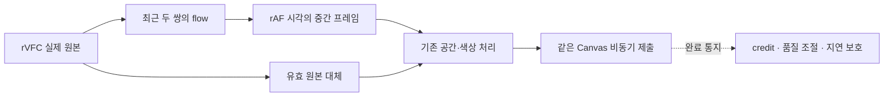

# Clarity v1.2.1 — 보간 최적화 재개 및 최종 안정화

기존 최적화를 보존하고 블록 왜곡·Canvas 전환·144FPS·원본 FPS별 정책을 수정했습니다. 최종 수치는 [측정 결과](STABILITY-RESULTS.md)와 원시 JSON을 기준으로 읽어 주세요. 여기서 FPS는 **Canvas 제출 FPS**입니다. 물리 패널에 표시된 고유 프레임 수와 청각적 A/V 동기화는 측정하지 않았습니다.

60초 이상 관찰에서 1080p60→120은 119.96FPS(중간 생성 110.95FPS), 1440p60→144는 최종 재검증 143.94FPS(중간 생성 135.10FPS)였습니다. 두 조건 모두 관찰 중 숨김 0회입니다. 실제 YouTube에서는 일부 짧은 전환과 보호 모드가 남아 아래에 별도 기록했습니다.

## 1. 이전 작업에서 유지한 변경 사항

코드를 초기화하거나 새 보간 엔진으로 교체하지 않았습니다. `optimized-source`, `optimized-dist`, `optimized-matrix.json`에 재개 전 최적화 상태를 동결했습니다. 원래 v1.2의 `baseline-source`, `baseline-dist`, `baseline-instrumented`도 유지합니다. [원래 병목 분석 기록](OPTIMIZATION-REPORT.ko.md), [최초 45조건 비교](PERFORMANCE.md).

유지한 핵심은 정상 보간 경로의 필수 서명 readback 제거, 비동기 GPU 제출, 최대 3개 제출 credit, 원본 스냅샷 3개, 최근 두 쌍의 움직임 벡터 재사용, rVFC 표시 시계, GPU 오류 복구입니다. 움직임 계산은 기존 v1.2도 원본 쌍당 한 번이었습니다. 매 rAF마다 다시 계산하던 버그로 설명하지 않습니다.

재개 전 기록의 720p 118.99FPS, 1080p 119.97FPS를 확인했고, 1440p 60→120도 119.82FPS였습니다. 이후 품질·시간 정책 변경의 영향을 받는 조건은 다시 측정했습니다. 실패한 중간 측정과 이전 수치를 최신 성공 수치로 바꾸지 않았습니다.

## 2. 새롭게 수정한 파일 및 주요 변경점

| 파일 | 변경 |
| --- | --- |
| `src/gpu/MotionEstimator.ts` | 품질 tier별 검색 범위, 미세 압축 차이 판정, 움직임 계측 |
| `src/shaders/motion-flow.wgsl` | 검색 경계에 몰린 부정확한 벡터의 신뢰도 제한 |
| `src/shaders/motion-warp.wgsl` | 색상 경계·신뢰도·이웃 일관성을 반영한 벡터 재구성, GPU 정지 판정, 정확한 A/B 끝점 |
| `src/gpu/WebGPUEngine.ts` | 원본 대체 출력도 비동기 encoder로 제출, 기존 공간·색상 pass 공유, GPU 오류 메시지·폐기 계측 |
| `src/temporal/InterpolationSession.ts` | 144Hz 근처 출력, 원본 정책, 안전한 원본 끝점, PTS 중복·역행 방지, 제한된 화면 유지, 10초 보호 모드 |
| `src/temporal/PresentationClock.ts`, `TemporalClock.ts` | native 표시 시계와 추가 지연 예산 분리, 미래 원본을 출력하지 않는 끝점 선택 |
| `src/temporal/SourcePolicy.ts` | 실제 타임스탬프 기반 원본 FPS별 적용 상한 |
| `src/content/VideoProcessor.ts`, `FrameScheduler.ts` | 동일 Canvas 원본 출력, 전환 사유, 유효한 정지 화면의 재생 재개 처리 |
| `src/content/VideoOverlay.ts` | 실제 표시·숨김 전환 횟수 |
| `src/settings/SettingsManager.ts`, `src/shared/types.ts`, `src/popup/*`, `harness/index.html` | 48/60/90/144 설정, 선택값과 적용값·지연·보호 상태 표시 |
| `src/harness/*`, `tests/*`, `scripts/*v121*` | 실제 GPU 픽셀·블록 위상·색상 조합·지속성·YouTube 검증 |

새 영상 효과, 오디오 처리, AI 모델, 안티에일리어싱은 추가하지 않았습니다. [파일별 변경·해시](source-comparison-final.json).

## 3. 사각형 왜곡의 원인과 해결 방법

**재현으로 확인한 원인**은 블록별 최근접 벡터의 불연속과 검색 범위를 넘는 이동입니다. 기존 기본 tier는 반경 8에서 거친 검색과 ±2 정밀 검색을 했습니다. 재현 입력의 12픽셀 이동은 그 범위를 넘었습니다. 텍스처 수명 오류를 이 현상의 확인된 원인으로 단정하지 않습니다. 버퍼 불일치·GPU 검증 오류도 함께 계측했습니다.

기본 tier의 반경을 12, 높은 tier를 16으로 조정했고 가장 낮은 tier의 반경 4는 유지했습니다. 범위 끝에 몰리면서 오차도 큰 벡터는 신뢰도를 낮춥니다. 합성에서는 블록 중심 좌표에 맞춘 네 이웃 벡터를 사용하되, 원본의 색상 경계와 신뢰도로 가중하고 벡터들이 서로 충돌하면 보수적으로 처리합니다. 기존 양방향 일관성 검사와 원본 선택도 유지합니다. 화면 전체를 블러 처리하지 않습니다.

단순 벡터 선형 보간 후보는 경계 지표만 좋아지고 전체 오차는 커져 채택하지 않았습니다. [실패 후보](artifacts/bilinear-candidate.json), [추가 후보](artifacts/edge-candidate.json).

합성 원본 A/B와 알려진 중간 위치를 사용해 두 블록 배치, 세 중간 시점에서 실제 GPU 출력 픽셀을 비교했습니다. 물체·가림·반대 이동의 평균 RMSE와 블록 경계 잔차가 감소했습니다. 반복 무늬 pan에서는 유의미한 개선을 확인하지 못했습니다. 오차가 0이 아니므로 모든 영상의 왜곡이 완전히 사라졌다고 주장하지 않습니다.

[21개 픽셀 비교 및 이미지](artifacts/comparison.json), [물체 이전](artifacts/object-0-0.5-previous.png), [물체 수정 후](artifacts/object-0-0.5-after.png), [실제 원본 A](artifacts/object-0-0.5-sourceA.png), [실제 원본 B](artifacts/object-0-0.5-sourceB.png), [합성 정답](artifacts/object-0-0.5-reference.png). 합성 정답은 테스트 장면의 정확한 위치이며 YouTube 개선 이미지로 제시하지 않습니다.

## 4. 깜빡임의 원인과 해결 방법

실제 Canvas 스타일 전환과 숨김 사유를 측정했습니다. 정지 24FPS 입력에서 이전 버전은 관찰 10초에 176회 숨김, 보정 표시 약 80.48%였습니다. 정지 원본은 약 41.7ms마다 바뀌는데 출력 목표 간격만으로 화면을 만료시키던 것이 원인이었습니다. 수정 후 해당 관찰은 숨김 0회, 표시 100%였습니다. 정지 영상에서 목표 횟수만큼 중복 제출해 FPS를 부풀리지 않았습니다. 생성 중간 프레임은 0개입니다. [전](previous-stability-flicker.json), [후](after-stability-flicker.json).

VP8 정지 영상의 작은 압축 차이를 움직임으로 잘못 분류하는 것도 확인했습니다. 계측된 차이 최대 약 0.000426에 대해 0.0005의 미세 차이 판정을 CPU/GPU에서 일치시켰습니다. 미세한 실제 움직임도 이 문턱 아래면 원본 출력으로 처리하는 절충입니다.

GPU 완료 통지를 15ms 늦춘 진단에서는 원본 대체 경로에 남은 동기 대기와 화면 만료가 겹쳐 15초에 125회 전환됐습니다. 원본 대체도 같은 Canvas의 비동기 제출 경로로 바꾸고, GPU 지연으로 표시를 유지하기 어려울 때 기존 보호 체계에서 10초 원본 FPS 공간·색상 보정으로 전환했습니다. 같은 주입 조건의 최종 15초 재실행에서 약 59.97FPS·표시 99.98%·짧은 숨김 1회를 기록했습니다. 이전의 125회 전환보다 감소했지만 이 부하에서 깜빡임이 완전히 제거되지는 않았습니다. **이 조건을 144FPS 성공으로 보고하지 않습니다.** 실제 저사양 GPU를 측정한 것이 아니라 완료 통지 지연을 주입한 시험입니다. [이전](pressure-before-native-stream.json), [수정 후](after-stability-pressure.json).

CPU 제출 기한 또는 출력 유효시간을 넘긴 경우에는 다음 rAF에서 현재 시각의 안전한 원본 끝점을 같은 Canvas로 재시도합니다. PTS 역행이나 무제한 오래된 화면 유지는 허용하지 않습니다. 새 9ms CPU 지연 재현에서도 제출이 계속되고 추가 숨김이 없는 것을 확인했습니다. [영향 회귀 8개](native-retry-regression.log).

쌍이 일시적으로 없으면 현재 표시 시각에 도달한 A 또는 B 원본을 같은 경로로 출력합니다. 미래 B를 미리 보여 주지 않고, 같은 PTS의 끝점을 중복 제출하지 않으며, 표시한 PTS보다 뒤로 돌아가는 보간도 보류합니다. 따라잡기 대기는 원본 한 주기 안의 제한된 유지 예산을 사용하고 오래된 프레임은 계속 만료시킵니다.

일시정지 후 재생에서도 숨김 2회를 재현했습니다. 완료된 원본 정지 화면의 유효 시간을 재개 시 다시 기준 잡고, 일시정지 중 남은 입력이 새 정지 화면을 덮지 않도록 수정했습니다. [수정 전 재현](pause-before-fix.log), [최종 회귀 검사](stability-browser-final.log).

탐색·실제 원본 해상도 변경·접근 제한·오래된 출력·GPU 오류에서는 안전을 위해 원본 플레이어로 전환할 수 있습니다. 모든 상황의 전환 횟수 0을 보장하지 않습니다.

## 5. 75/100/120/144FPS 및 저프레임 정책

| 타임스탬프로 분류한 원본 | 적용 가능한 보간 목표 |
| --- | --- |
| 약 24 / 23.976 | 48 / 60 |
| 약 30 / 29.97 | 60 / 90 |
| 약 60 / 59.94 | 75 / 100 / 120 / 144 |

원본 설정은 항상 유지합니다. 기존 사용자가 24FPS 영상에서 120을 선택해 두었다면 선택값 120을 저장한 채 실제 60 적용과 사유를 표시합니다. 저장값을 몰래 변경하지 않습니다. 시작 시 최소 8개 간격을 확인하고 최근 40개 간격의 중앙값으로 일시적 콜백 누락을 완화합니다. 재생 속도를 분리해 원본을 분류하며 탐색·속도·시계 불연속에서는 재확인합니다. 밀리초 단위 WebM에서는 분류용 추정 FPS와 장시간 실제 FPS가 조금 다를 수 있습니다.

실제 그림이 6FPS로 갱신되는 60FPS 입력도 따로 측정했습니다. 정지·반복 부분은 중간 프레임으로 세지 않고 보정 Canvas를 유지합니다. 헤더 FPS만으로 고유 화면 144개가 만들어졌다고 주장하지 않습니다.

144Hz 근처에서는 6.9/7.0ms 시간 양자화로 인한 불필요한 누산기 건너뛰기를 줄이고 rAF에 맞춥니다. 낮은 주사율은 실제 적용 상한을 제한하며, 목표 FPS를 맞추기 위해 한 rAF에 여러 번 몰아 제출하지 않습니다. 결과와 간격 분포는 [최종 표](STABILITY-RESULTS.md)를 참조하세요.

### 시간차와 A/V 정책

브라우저 예상 표시 시각과 프레임 PTS를 사용합니다. 이 두 값의 의미는 [rVFC 명세](https://wicg.github.io/video-rvfc/)에 정의되어 있습니다. 연속 `video.currentTime`과 같은 순간의 프레임 표시 시각을 동일 값으로 가정하지 않습니다.

최종 검증 중 24FPS에서 원본 표시 시계 차이 약 59.4ms와 정상 보간 대기 약 42ms가 합쳐져, 임의의 총 100ms 검사에 걸리는 실패를 발견했습니다. 24→48은 약 34FPS, 24→60은 약 7.43FPS였으며 [실패 원본](stability-matrix-before-timeline.json)을 보존했습니다.

**추가 지연 45ms 검사는 유지했습니다.** 원본 표시 시계 허용 오차는 `max(45ms, 원본 주기 × 2)`로 제한하고, 전체 시간차는 이 허용 오차와 추가 지연 45ms의 합으로 검사합니다. 주기는 45ms에서 제한하므로 전체 보호 한도는 90~135ms입니다. 예를 들어 60FPS는 90ms, 24FPS는 약 128~129ms입니다. 브라우저 원본 지연을 확장의 계산 지연으로 오판하던 검사를 분리한 것이며, 이 변경이 A/V 안전을 청각적으로 입증한 것은 아닙니다.

보간은 원본 한 프레임의 대기를 사용하고 외삽하지 않습니다. 출력 사이 유지 시간·마감·시계 불연속도 별도로 검사합니다. 따라서 실제 화면에서 항상 추가 지연 45ms 이내라는 보장은 없습니다. 오디오를 지연시키거나 변경하지 않으며 엄격한 립싱크가 필요한 경우에는 원본 FPS가 적합합니다.

## 6. 720p / 1080p / 1440p 성능 비교

[최종 측정 표](STABILITY-RESULTS.md), [최종 CSV](stability-comparison.csv)에 720p60→75/100/120, 1080p60→120/144, 1440p60→120/144와 저프레임 네 조건을 모두 기록했습니다. 24→48/60은 서로 다른 실행 3회를 기록했습니다. 성공한 조건만 고르지 않고 미달·보류·오류를 함께 표시합니다.

빠른 이동과 8초 시점 컷을 포함한 1080p60→120 시험은 약 119.92FPS, 중간 생성 약 110.44FPS, 숨김 0회였습니다. 장면 전환 1회를 감지했고 컷 사이의 중간 생성을 생략했습니다. [빠른 이동·컷 원시 기록](after-stability-fast.json).

각 일반 조건은 3초 준비 후 10초 이상입니다. 지속성은 별도 65초 영상으로 3초 준비 후 60초 이상을 관찰했습니다. 16초 영상 루프를 60초 연속 원본으로 설명하지 않습니다. 최신 지속성 결과는 [원시 JSON](after-stability-long.json)에 있습니다.

업스케일링·색상 여섯 조합은 640×360 60FPS 입력, 144FPS 목표, 공간 확대는 Balanced 720p를 사용했습니다. 실제 해상도·생성률·간격·전환을 함께 수집했습니다. 최종 평균만으로 매 마감이나 물리 고유 144프레임 달성을 주장하지 않습니다.

## 7. GPU 처리시간 및 프레임 안정성 분석

실제 환경은 NVIDIA RTX 4060 Ti, Windows 2560×1440입니다. WMI는 143Hz, 브라우저 rAF는 약 144회/초였고 WebGPU adapter는 NVIDIA/Lovelace였습니다. 주 벤치마크는 headless Chromium입니다. [하드웨어](hardware.json), [adapter 및 최종 측정](after-stability-matrix.json).

GPU timestamp-query로 downsample·flow·warp·denoise·EASU·composite를 구분했습니다. CPU 획득·업로드 API·제출·유효성 검사와 비동기 완료 통지도 따로 기록했습니다. queue 완료 통지는 CPU·queue·브라우저 전달 지연을 포함하며 GPU 커널 시간과 다릅니다. 실제 GPU 업로드만의 시간과 panel scanout은 측정할 수 없었습니다.

질의는 선택적이며 일반 모드에는 GPU 서명·timestamp readback이 없습니다. 정상 보간에 필요한 32바이트 분석 요약의 비동기 읽기는 남습니다. 질의는 네 슬롯, 분석은 세 슬롯으로 제한하고 슬롯이 없으면 계측·분류를 생략합니다. 짧은 GPU pass는 약 0.065536ms 단위로 양자화되어 0으로 나올 수 있습니다. [WebGPU 질의 명세](https://gpuweb.github.io/gpuweb/#timestamp-query).

긴 진단의 단계별 표본은 각 8,192개로 제한됩니다. 전체 제출 카운터와 독립적으로 수집한 제출 간격은 관찰 구간 전체를 포함합니다. 표시 비율은 최근 2초 DOM 표시 이력의 비율을 주기적으로 표본화한 평균입니다. 관찰 전체의 정확한 적분 비율과는 구분하고, 실제 숨김 횟수도 함께 읽어야 합니다. p50/p95/p99는 실제 queue 제출 간격이며 물리 모니터 표시 간격이 아닙니다. 120FPS를 144Hz에 맞추면 한 칸/두 칸 간격이 섞이는 정상적인 주사율 양자화도 포함됩니다.

A/B/C 분리 시험도 수행했습니다. A는 확대·색상 변화·보간 없는 원본 FPS GPU 출력, B는 진단 전용 120FPS 원본 반복, C는 화면 제출 없는 flow/warp, D는 전체 파이프라인입니다. B의 생성 수는 0이며 보간 성공으로 세지 않습니다. C의 반복 속도에는 CPU 입력·scope·분석 완료 대기가 포함되므로 GPU timestamp와 구분합니다. [분리 결과](ablation.json).

품질 개선에는 GPU 비용이 듭니다. 검색과 벡터 재구성이 더 비싸졌으므로 처리 비용이 같거나 GPU 사용률이 줄었다고 주장하지 않습니다. 기존 120FPS와 목표 144FPS에 대한 실제 제출·GPU 시간으로 판단했습니다. 기존 적응형 tier·분석 크기·공간 품질·빈도 조절과 cooldown은 유지합니다.

## 8. 기존 업스케일링·색상·설정·복구와의 호환성

FSR1 EASU, Fast, denoise, 색상, composite를 포함해 13개 셰이더 파일 중 보간 두 파일을 제외한 11개는 원래 v1.2와 같습니다. WebGL2 공간 엔진도 같습니다. 설정 정규화는 새 FPS 문자열만 추가했고 기본값은 원본 FPS·1080p·색상 100%입니다. [SHA-256 비교](source-comparison-final.json).

보간·밝기·채도·확대 여섯 조합은 실제 streaming Canvas compositor 픽셀로 검사했습니다. 예를 들어 RGB 64/128/192는 중립에서 그대로이며, 밝기·채도 150% 동시 적용은 약 0/149/239로 확인했습니다. 중립 identity, 0~200% 색상 범위, 720p~4K 조건, 기존 8개 pass 조합도 보존했습니다.

표시 레이어·비교·일시정지·탐색·resize·설정 저장·CORS·DRM 거부·장치 손실·응답 정체·셰이더 오류를 검사했습니다. WebGL2는 공간·색상만 지원하며 보간은 미지원으로 표시합니다. 원본 플레이어·오디오·자막·컨트롤을 계속 사용하고 보안 제한을 우회하지 않습니다.

텍스처는 보간 시 13개를 재사용하고, 보간 끔에서 3개, 종료에서 0개입니다. 지속성에서는 생성 수와 최대 생존 수도 기록했습니다. 이것을 전체 프로세스 VRAM 누수 검증이나 수 시간 열 안정성 검증으로 확대 해석하지 않습니다.

| 실행 명령 | 최종 기록 |
| --- | --- |
| `npm run build` | [빌드·MV3 자산 검사](stability-build.log) |
| `npm run test` | [단위 84개](stability-unit.log) |
| `npm run test:browser` | [전체 36개 통과](stability-browser-final.log), 마지막 복구 변경 후 [관련 8개 통과](native-retry-regression.log), 새 재현 포함 총 37개 중 전체 재실행은 생략 |
| `node scripts/run-final-v121.mjs` | [최종 순차 검증](final-validation.log), [작업별 상태](final-validation-status.json) |

마지막 원본 재시도 변경 후에는 앞선 행렬에서 실패·보류가 있었던 세 조건만 [재검증](after-stability-retry-recheck.json)했습니다. 1080p 지속성은 해당 카운터가 0이므로 성공 기록을 보존했습니다. 1440p 지속성은 GPU backpressure 1회가 있어 최신 코드로 60초 다시 관찰했습니다. 추가 결과는 after-stability-long-final.json에 보존했습니다.

이미 통과한 결과는 보존했고, 실제 수정 영향이 생긴 조건과 새 재현 사례만 추가·재검증했습니다. 실행 중 실패한 정지 분류·원본 대체·시간 가드·일시정지 사례도 원시 로그에 남겼습니다.

## 9. 실제 YouTube 환경 검증

[최종 YouTube 기록](youtube-stability-final.json)에는 각 실행의 공개 URL, 선택한 실제 화질, 실제 원본 FPS, 적용 상한, GPU 상태, 제출·생성률, 전환, 영상 시간 진행과 플레이어 오류가 있습니다. 자동 화질에서는 제목이 60FPS여도 실제 입력이 30FPS인 경우가 있어 실제 디코딩 FPS로 구분했습니다. 24FPS, 480p 30FPS, 720p60 형식을 구분하고 60FPS 사례에서는 확대·색상도 함께 적용했습니다.

초기 검증에서는 같은 페이지를 뒤로 반복 탐색한 뒤 YouTube 자체 오류 화면과 너비 0·일시정지가 발생했습니다. 그 구간을 GPU 성능 성공/실패 수치로 혼합하지 않습니다. [초기 시도](youtube-v121.json)와 [오류 화면](youtube-v121-YE7VzlLtp-4.png)을 보존했고, 최종 시험은 모드마다 새 페이지에서 시작했습니다. 메시지 수신 탭을 정확히 찾고 content-script 준비도 기다립니다.

최신 여섯 실행은 모두 측정한 원본 FPS와 선택 형식이 일치하고 재생 시간도 진행했습니다. 일반 모드의 제출/중간 생성 FPS는 24FPS 입력에서 59.87/59.78, 30FPS에서 88.30/81.52, 60FPS 확대·색상 입력에서 133.57/114.62였습니다. 60FPS 일반 모드에는 관찰 중 숨김 1회가 남았고, 24FPS 진단에도 1회가 남았습니다. 30FPS 진단은 보호 모드 1회로 평균 제출 44.18FPS까지 낮아졌습니다. 같은 60FPS 진단은 132.13FPS였습니다. 따라서 실제 사이트에서 항상 144FPS나 전환 0회를 달성했다고 보고하지 않습니다. 준비 구간을 포함하는 사유 카운터와 관찰 구간만의 전환 수는 구분했습니다.

일반·극장·전체화면·실제 비교 픽셀의 기존 검사도 별도로 보존했습니다. [레이아웃 및 픽셀 기록](youtube-validation.json), [Chrome/Edge GPU 검사](browser-validation.json). 실제 사이트에서 검증하지 못했거나 재생이 중단된 구간은 최종 표에 표시합니다.

## 10. 남은 문제와 재현 조건

- 주기적인 무늬·가림·회전·매우 빠른 이동에서는 추정의 모호함과 국소 왜곡이 남을 수 있습니다. 합성 픽셀 개선이 자연 영상 모든 장면의 완전한 제거 증명은 아닙니다.
- 정지·반복·낮은 실제 그림 갱신 입력은 중간 생성이 줄고 Canvas 제출도 목표보다 낮을 수 있습니다. 이를 중복 프레임으로 감추지 않습니다.
- GPU·CPU·사이트 부하가 크면 144FPS에 못 미치거나 원본 FPS 보호 모드로 전환합니다. 10초 보호는 원본 FPS를 유지하며 선택 설정은 그대로 남깁니다. 실제 저사양 카드에서의 성능은 미검증입니다.
- 완료 통지를 15ms 늦추는 1080p60→144 진단 주입에서는 원본 FPS 보호 모드로 전환하며 최종 15초에 짧은 숨김 1회가 남았습니다. 보간 144FPS 성공이나 깜빡임 완전 제거로 보고하지 않습니다.
- 시계 불연속·진짜 오래된 화면·탐색·소스 변경·접근 제한에서는 원본 전환이 필요합니다. 모든 전환을 없애기 위해 오래된 프레임을 무기한 유지하지 않습니다.
- 실제 패널의 고유 144프레임, 청각적 립싱크, HDR, 모든 자연 영상의 정답 중간 프레임, 수 시간 발열·VRAM 안정성은 검증하지 않았습니다. 실제 YouTube는 muted로 시험했습니다.

설치본은 프로젝트 루트의 `clarity-extension-v1.2.1.zip`과 `dist`입니다. 확장을 다시 로드한 뒤 기존 YouTube 탭도 새로고침해야 합니다. [패키지 검증·해시](package-verification.json).

Windows 어댑터 경고 후속 수정: Chromium이 무시하는 powerPreference를 Windows에서는 전달하지 않고 다른 OS의 저전력 힌트는 유지합니다. 셰이더·보간·화질 경로는 바꾸지 않았습니다. 수정 후 빌드와 실제 WebGPU 픽셀 검사 1개를 통과했고 해당 경고가 발생하지 않음을 검사했습니다. [빌드](windows-adapter-build.log), [GPU 검사](windows-adapter-browser.log). 위 성능·YouTube 측정은 이 옵션 수정 전 기록이며 반복 측정하지 않았습니다. 이전 빌드 해시는 stability-measured-build-before-windows-adapter.json에 보존했습니다.
