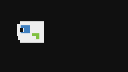
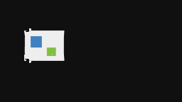

# 최종 안정화 측정 결과

생성: 2026-10-31T22:44:15.132Z (UTC, 한국은 +9시간)

표시 %는 최근 2초 DOM 이력 비율을 표본화한 평균입니다. 관찰 전체의 정확한 적분 비율과는 다릅니다. 수치는 실제 queue에 제출한 Canvas 프레임입니다. 고유 물리 scanout을 측정하지 않았습니다. 3초 준비 후 일반 조건 10초 이상, 지속 조건 60초 이상입니다. 서명은 끄고 진단 조건에서는 timestamp-query만 켰습니다.

브라우저: Chromium 156.0.8078.4. WebGPU adapter: {"vendor":"nvidia","architecture":"lovelace","device":"","description":"","features":["depth32float-stencil8","rg11b10ufloat-renderable","bgra8unorm-storage","texture-formats-tier1","texture-compression-bc","dual-source-blending","core-features-and-limits","float32-filterable","indirect-first-instance","float32-blendable","subgroup-size-control","depth-clip-control","texture-compression-bc-sliced-3d","shader-f16","timestamp-query","clip-distances","texture-formats-tier2","primitive-index","texture-component-swizzle","subgroups"]}. NVIDIA/Lovelace는 브라우저가 반환한 값이고 정확한 보드명 RTX 4060 Ti와 2560×1440/143Hz는 hardware.json의 WMI 기록입니다.

## 최종 목표·해상도별 결과

| 크기 | 원본→목표 | 실제 적용 상한 | 평균 Canvas FPS | 중간 생성 FPS | 보정 표시 % | 표시/숨김 전환 | 평균 98% 기준 |
| --- | --- | ---: | ---: | ---: | ---: | --- | --- |
| 1280×720 | 60→75 | 75.00 | 74.99 | 70.20 | 100.00 | 0 / 0 | 근접 |
| 1280×720 | 60→100 | 100.00 | 99.98 | 95.56 | 100.00 | 0 / 0 | 근접 |
| 1280×720 | 60→120 | 120.00 | 120.01 | 109.35 | 100.00 | 0 / 0 | 근접 |
| 1920×1080 | 60→120 | 120.00 | 119.83 | 113.27 | 100.00 | 0 / 0 | 근접 |
| 1920×1080 | 60→144 | 144.00 | 144.01 | 136.08 | 100.00 | 0 / 0 | 근접 |
| 2560×1440 | 60→120 | 120.00 | 119.92 | 114.92 | 100.00 | 0 / 0 | 근접 |
| 2560×1440 | 60→144 | 144.00 | 143.13 | 133.54 | 100.00 | 0 / 0 | 근접 |
| 256×144 | 24→48 | 48.00 | 47.92 | 45.77 | 100.00 | 0 / 0 | 근접 |
| 256×144 | 24→60 | 60.00 | 59.93 | 56.30 | 100.00 | 0 / 0 | 근접 |
| 256×144 | 30→60 | 60.00 | 60.01 | 54.81 | 100.00 | 0 / 0 | 근접 |
| 256×144 | 30→90 | 90.00 | 89.85 | 89.76 | 100.00 | 0 / 0 | 근접 |

98%는 평균 제출률의 보고용 기준이며 모든 프레임 마감 성공이나 고유 144개 패널 표시의 판정이 아닙니다. 모든 사례의 생성 수·오류·최종 상태는 [원시 자료](after-stability-matrix.json)에 있습니다.

| 조건 | 제출 간격 p50 / p95 / p99 / 최대 ms | 250ms FPS 구간 p10 / p01 | 마감 실패 | rAF 계획 미제출률 % |
| --- | --- | --- | ---: | ---: |
| 720p 60→75 | 13.80 / 14.60 / 15.70 / 18.20 | 72.46 / 71.11 | 0 | 0.00 |
| 720p 60→100 | 7.10 / 14.30 / 14.40 / 15.20 | 97.01 / 95.97 | 0 | 0.00 |
| 720p 60→120 | 7.00 / 14.20 / 14.30 / 15.10 | 117.74 / 115.52 | 0 | 0.00 |
| 1080p 60→120 | 7.00 / 14.10 / 14.40 / 16.00 | 117.25 / 116.24 | 0 | 0.00 |
| 1080p 60→144 | 6.90 / 7.50 / 7.90 / 10.10 | 141.98 / 141.33 | 0 | 0.00 |
| 1440p 60→120 | 7.00 / 14.10 / 14.20 / 18.70 | 116.76 / 115.38 | 0 | 0.00 |
| 1440p 60→144 | 7.00 / 7.40 / 7.90 / 20.60 | 139.15 / 123.50 | 0 | 0.41 |
| 144p 24→48 | 20.80 / 28.00 / 28.80 / 41.60 | 45.16 / 45.11 | 0 | 0.20 |
| 144p 24→60 | 13.90 / 21.40 / 21.80 / 27.20 | 57.23 / 56.75 | 0 | 0.00 |
| 144p 30→60 | 14.20 / 21.00 / 21.50 / 22.60 | 57.52 / 56.82 | 0 | 0.00 |
| 144p 30→90 | 13.70 / 14.20 / 14.60 / 22.90 | 87.09 / 86.63 | 0 | 0.00 |

120FPS와 75/100/90/60/48은 144Hz의 정수 약수가 아니거나 source 위상이 달라 한 칸/두 칸 간격이 섞입니다. 간격은 CPU queue 제출 시각이며 실제 scanout 시각이 아닙니다. 중간 생성 수는 움직임·장면·alpha가 확인된 제출만 포함합니다.

## 저프레임 재실행의 변동

24→48/60은 최종 행렬 1회와 별도 2회, 합계 각 3회입니다. 준비·관찰 조건과 입력 파일은 같습니다.

| 목표 | 회차 | 평균 FPS | 생성 FPS | 표시 % | 숨김 | 전체 시간차 최대 ms | 추가 지연 최대 ms |
| --- | ---: | ---: | ---: | ---: | ---: | ---: | ---: |
| 48 | 1 | 47.92 | 45.77 | 100.00 | 0 | 84.50 | 44.80 |
| 48 | 2 | 48.04 | 48.04 | 100.00 | 0 | 98.70 | 44.50 |
| 48 | 3 | 47.92 | 40.29 | 100.00 | 0 | 94.10 | 44.40 |
| 48 평균 / 범위 | — | 47.96 (47.92~48.04) | — | — | — | — | — |
| 60 | 1 | 59.93 | 56.30 | 100.00 | 0 | 94.80 | 44.20 |
| 60 | 2 | 60.02 | 56.09 | 99.96 | 0 | 94.90 | 44.70 |
| 60 | 3 | 59.92 | 55.99 | 100.00 | 0 | 91.70 | 44.60 |
| 60 평균 / 범위 | — | 59.95 (59.92~60.02) | — | — | — | — | — |

수정 전 100ms 총 한도에 걸린 34.04/7.43FPS 실패는 [수정 전 행렬](stability-matrix-before-timeline.json)에 유지했습니다. 추가 지연 45ms를 늘린 결과로 설명하지 않습니다. 원본 표시 시계의 허용 오차와 추가 지연 예산을 합친 현재 한도는 원본 주기에 따라 달라집니다. 실제 화면 유지 시간과 음향 출력까지 포함한 A/V 보장은 아닙니다.

## 60초 이상 지속성

65초 입력을 사용하여 관찰 중 루프가 발생하지 않습니다. 두 번째 조건은 밝기 125%, 채도 150%도 적용했습니다.

| 조건 | 관찰 초 | Canvas / 생성 FPS | 간격 p50 / p95 / p99 ms | 표시 % | 표시/숨김 | 활성/생성/최대 텍스처 | 마지막 영상 시각 |
| --- | ---: | --- | --- | ---: | --- | --- | ---: |
| 1080p60→120 | 60.04 | 119.96 / 110.95 | 7.10 / 13.90 / 14.10 | 100.00 | 0 / 0 | 13 / 13 / 13 | 63.10 |
| 1440p60→144 | 60.07 | 143.94 / 135.10 | 6.90 / 7.40 / 7.70 | 100.00 | 0 / 0 | 13 / 13 / 13 | 63.10 |

[지속성 JSON](after-stability-long.json). GPU 단계 표본은 8,192개까지 저장하므로 144FPS의 단계 요약은 전체 60초보다 짧은 구간일 수 있습니다. 제출 카운터·독립 간격 audit·가시성 표는 전체 관찰을 포함합니다.

## 실제 조합 적용

| 조합 | 밝기 / 채도 | 실제 출력 | Canvas / 생성 FPS | 표시 % | 숨김 | GPU EASU 평균 ms |
| --- | --- | --- | --- | ---: | ---: | ---: |
| 보간 | 100% / 100% | 640×360 | 143.93 / 135.50 | 100.00 | 0 | — |
| 보간+밝기 | 125% / 100% | 640×360 | 143.97 / 135.95 | 100.00 | 0 | — |
| 보간+채도 | 100% / 150% | 640×360 | 143.11 / 133.51 | 99.99 | 1 | — |
| 보간+밝기+채도 | 125% / 150% | 640×360 | 143.85 / 135.37 | 100.00 | 0 | — |
| 보간+EASU | 100% / 100% | 1280×720 | 143.97 / 135.64 | 100.00 | 0 | 0.6614 |
| 보간+EASU+밝기+채도 | 125% / 150% | 1280×720 | 143.90 / 135.37 | 99.97 | 1 | 0.3179 |

640×360 60FPS, 144FPS 목표, 자동 품질 조절 끔, 확대 시 Balanced 720p, 선명도·노이즈 0입니다. 색상 변환은 기존 최종 composite에 통합되어 별도 색상 pass를 만들지 않습니다. 실제 compositor의 여섯 조합 픽셀은 stability.spec.ts와 [브라우저 로그](stability-browser-final.log)에서 검증했습니다.

## GPU/CPU 분리

| 조건 | GPU flow ms | GPU warp ms | GPU composite ms | 출력 CPU 제출 ms | 비동기 완료 통지 ms | 품질 tier / 분석 폭 |
| --- | ---: | ---: | ---: | ---: | ---: | --- |
| 720p60→120 | 0.6864 | 0.6135 | 0.0844 | 0.0793 | 4.1271 | 1 / 256 |
| 1080p60→120 | 0.3084 | 0.6559 | 0.2101 | 0.0856 | 4.2901 | 1 / 256 |
| 1080p60→144 | 0.3780 | 0.5482 | 0.0883 | 0.0871 | 4.3363 | 1 / 256 |
| 1440p60→120 | 0.4061 | 1.1232 | 0.1448 | 0.0860 | 4.0513 | 1 / 256 |
| 1440p60→144 | 0.3685 | 1.0111 | 0.1850 | 0.0891 | 4.2347 | 1 / 256 |
| 1080p60→120 지속 | 0.6363 | 1.0622 | 0.1273 | 0.0923 | 3.9901 | 1 / 256 |
| 1440p60→144 지속 | 0.4005 | 0.9150 | 0.2680 | 0.0878 | 4.6130 | 1 / 256 |

완료 통지는 capture와 output을 포함한 queue acknowledgement이며 GPU 커널 시간이 아닙니다. 업로드 API의 CPU 시간과 실제 GPU 업로드 시간도 구분합니다. 정확히 분리되지 않는 GPU 업로드·scanout·청각적 A/V는 측정 불가입니다.

| 조건 | 시도 | temporal 제출 | 원본 직접 제출 | GPU backpressure | 쌍 없음 | timeline 보류 | 마감 | invalidated | tooEarly / tooLate | 전체 지연 | 버퍼 오류 |
| --- | ---: | ---: | ---: | ---: | ---: | ---: | ---: | ---: | --- | ---: | ---: |
| 720p 60→75 | 767 | 767 | 0 | 0 | 0 | 0 | 0 | 0 | 0 / 0 | 0 | 0 |
| 720p 60→100 | 1019 | 1019 | 0 | 0 | 0 | 0 | 0 | 0 | 0 / 0 | 0 | 0 |
| 720p 60→120 | 1227 | 1227 | 0 | 0 | 0 | 0 | 0 | 0 | 0 / 0 | 0 | 0 |
| 1080p 60→120 | 1223 | 1223 | 0 | 0 | 0 | 0 | 0 | 0 | 0 / 0 | 0 | 0 |
| 1080p 60→144 | 1470 | 1470 | 0 | 0 | 0 | 0 | 0 | 0 | 0 / 0 | 0 | 0 |
| 1440p 60→120 | 1223 | 1223 | 0 | 0 | 0 | 0 | 0 | 0 | 0 / 0 | 0 | 0 |
| 1440p 60→144 | 1468 | 1462 | 0 | 0 | 6 | 3 | 0 | 0 | 0 / 0 | 0 | 0 |
| 144p 24→48 | 491 | 490 | 0 | 0 | 0 | 0 | 0 | 0 | 0 / 1 | 0 | 0 |
| 144p 24→60 | 611 | 611 | 0 | 0 | 0 | 0 | 0 | 0 | 0 / 0 | 0 | 0 |
| 144p 30→60 | 612 | 612 | 0 | 0 | 0 | 0 | 0 | 0 | 0 / 0 | 0 | 0 |
| 144p 30→90 | 920 | 920 | 0 | 0 | 0 | 0 | 0 | 0 | 0 / 0 | 0 | 0 |

쌍 없음 뒤 원본 대체가 성공할 수 있으므로 사유 카운터 합을 실제 출력 손실률로 사용하지 않습니다. 정적·컷·중복 끝점·숨김·seek/해상도 변경·GPU 오류 등 나머지 카운터는 각 원시 JSON에 있습니다.

## 일반 / 진단

| 크기 60→144 | 일반 FPS | 진단 FPS | 일반 숨김 | 진단 숨김 |
| --- | ---: | ---: | ---: | ---: |
| 1080p | 143.92 | 144.01 | 0 | 0 |
| 1440p | 143.99 | 143.13 | 0 | 0 |

일반 모드는 timestamp-query·서명 읽기 끔입니다. 독립 제출 audit는 두 모드에 동일하게 적용했습니다. 단일 실행 간 차이에는 환경 변동도 포함되며 순수 계측 비용으로 단정하지 않습니다.

## 블록 아티팩트 픽셀

| 재현 종류 | 개수 | RMSE 이전→수정 | 블록 경계 잔차 이전→수정 |
| --- | ---: | --- | --- |
| object | 6 | 14.2835 → 8.5873 | 2.9532 → 0.5355 |
| pan | 3 | 18.3758 → 18.3770 | 26.1377 → 26.0246 |
| occlusion | 6 | 13.0155 → 9.0225 | 5.6974 → 3.7146 |
| opposed | 6 | 14.8775 → 9.7327 | 3.3569 → 0.9137 |

| 이전 GPU 출력 | 수정 GPU 출력 | 알려진 중간 위치 |
| --- | --- | --- |
|  |  |  |

픽셀 오차가 남습니다. 이 그림은 합성 진단이며 자연 영상의 완전한 왜곡 제거를 증명하지 않습니다. [모든 입력·정답·출력](artifacts/comparison.json).

## 가시성 / 압력 보호

| 조건 | 버전 | Canvas FPS | 생성 FPS | 표시 % | 표시/숨김 |
| --- | --- | ---: | ---: | ---: | --- |
| 정지 24→60 | 이전 | 26.08 | 3.43 | 80.48 | 176 / 176 |
| 정지 24→60 | 수정 | 24.15 | 0.00 | 100.00 | 0 / 0 |
| 그림 6Hz / 소스60→144 | 이전 | 83.94 | 14.87 | 99.03 | 25 / 25 |
| 그림 6Hz / 소스60→144 | 수정 | 84.06 | 12.05 | 100.00 | 0 / 0 |
| 완료통지 +15ms | 이전 | 69.27 | 63.02 | 96.67 | 125 / 125 |
| 완료통지 +15ms | 수정 | 59.97 | 0.59 | 99.98 | 1 / 1 |

압력 수정 후 값은 원본 FPS 보호 모드입니다. 144FPS로 세지 않습니다. 이 시험은 진단 주입이며 실제 저사양 카드 결과가 아닙니다. 원본 대체도 GPU 공간·색상 처리를 유지합니다. 정지 steady 경로의 10초 기록은 원본 대체 비동기화 전부터 변화가 없었던 결과를 재사용했고 최종 정지·재생 재개·50ms 통지 지연 회귀 검사는 최신 코드로 통과했습니다.

## A/B/C 분리 시험

| 모드 | 이전 | 안정화 | 의미 |
| --- | ---: | ---: | --- |
| A | 58.42 | 56.25 | 원본 FPS GPU 출력 |
| B | 120.00 | 120.03 | 진단 전용 원본 반복; 생성 0 |

| C: 화면 제출 없음 | 쌍/초 | GPU flow 평균 ms | GPU warp 평균 ms |
| --- | ---: | ---: | ---: |
| baseline 256×144 | 249.18 | 0.4875 | 0.0162 |
| baseline 1280×720 | 247.12 | 0.3732 | 0.1985 |
| baseline 2560×1440 | 256.41 | 0.2423 | 0.8439 |
| after 256×144 | 249.79 | 0.5510 | 0.0233 |
| after 1280×720 | 255.10 | 0.4670 | 0.1741 |
| after 2560×1440 | 256.75 | 0.2602 | 0.4929 |

C는 2초 준비·10초 관찰, CPU 입력·업로드·요약 완료도 포함한 반복 처리입니다. source 쌍당 flow 1회와 warp 1회이며 전체 출력 최대 FPS가 아닙니다. 최종 전체 파이프라인은 위 D 측정으로 확인했습니다. A/B/C는 마지막 시간 가드 변경의 영향을 받지 않는 동결·안정화 GPU 경로의 계측입니다.

## 실제 YouTube

각 모드는 새 페이지이며 가능한 480p24 / 480p30 / 720p60을 메뉴로 선택했습니다. 144 요청은 저장하고 정책이 60/90/144 상한을 적용합니다. 원본 FPS는 제목이 아니라 측정값입니다. 진단 단계 요약에는 준비 3초도 포함되고, FPS/가시성/전환은 그 뒤 10초 이상입니다.

| 목표 원본 / 모드 | 선택 화질 | 실제 원본 FPS | 적용 상한 | Canvas / 생성 FPS | 표시 % | 표시/숨김 | 판정 |
| --- | --- | ---: | ---: | --- | ---: | --- | --- |
| 24 / 일반 | 480p | 24.00 | 60.00 | 59.87 / 59.78 | 100.00 | 0 / 0 | 재생·형식 확인 |
| 24 / 진단 | 480p | 24.00 | 60.00 | 59.23 / 48.66 | 99.96 | 1 / 1 | 재생·형식 확인 |
| 30 / 일반 | 480p | 30.00 | 90.00 | 88.30 / 81.52 | 100.00 | 0 / 0 | 재생·형식 확인 |
| 30 / 진단 | 480p | 30.00 | 90.00 | 44.18 / 21.27 | 100.00 | 0 / 0 | 재생·형식 확인 |
| 60 / 일반 | 720p60 | 60.00 | 144.00 | 133.57 / 114.62 | 99.96 | 1 / 1 | 재생·형식 확인 |
| 60 / 진단 | 720p60 | 60.00 | 144.00 | 132.13 / 114.05 | 100.00 | 0 / 0 | 재생·형식 확인 |

[URL·프레임 수·시간 진행·중단 사유·GPU·레이아웃 원본](youtube-stability-final.json). 중단·사이트 오류를 GPU 성능 수치로 해석하지 않습니다. 자연 영상의 생성률은 정지·컷·압축·적응형 품질에 영향을 받습니다. 실제 패널 표시와 청각적 A/V는 미검증입니다.

## 기존 브라우저 / 레이아웃 / 명령

| 브라우저 | 버전 | WebGPU 픽셀 | WebGL2 픽셀 | 오류 |
| --- | --- | --- | --- | --- |
| chrome | 156.0.8078.76 | 통과 | 통과 | 없음 |
| msedge | 156.0.4314.50 | 통과 | 통과 | 없음 |

실제 기존 비교 픽셀: true; 왼쪽 평균 차이 0.2875, 오른쪽 1.2684. 레이아웃: standard=true, theater=true, fullscreen=true, seek and playback speed 1.25x=true, window resize=true.  이 기존 검사는 원본 FPS 모드이며 최종 YouTube 60FPS 일반 실행의 theater/fullscreen 결과는 별도 원시 기록에 있습니다.

`npm run build` 통과, `npm run test` 84개 통과, `npm run test:browser` 36개 통과. [빌드](stability-build.log), [단위](stability-unit.log), [브라우저](stability-browser-final.log). 실행 코드와 패키지의 해시는 package-verification.json에 기록합니다.

## 마지막 원본 재시도 변경의 영향 조건 재검증

CPU 제출 마감/유효시간 실패 후 다음 rAF에서 현재의 안전한 원본 끝점을 재시도하는 변경입니다. 1080p 지속성과 일반 모드 두 조건은 해당 실패·보류 카운터가 0이어서 기존 성공 기록을 보존했습니다. 1440p 지속성은 GPU backpressure 1회가 있어 최신 코드로 60초 다시 관찰했습니다. 위 지속성 표는 이 추가 관찰을 사용하며 [추가 원시 기록](after-stability-long-final.json)에 있습니다. 행렬의 영향 세 조건과 새 9ms CPU 지연 재현도 추가 검증했습니다.

| 조건 | Canvas / 생성 FPS | 표시 % | 표시/숨김 | native 재시도 |
| --- | --- | ---: | --- | ---: |
| 1440p 60→144 | 143.88 / 135.00 | 100.00 | 0 / 0 | 0 |
| 144p 24→48 | 48.01 / 40.21 | 100.00 | 0 / 0 | 0 |
| 360p 60→144 채도150% | 143.61 / 135.67 | 100.00 | 0 / 0 | 0 |

[재검증 JSON](after-stability-retry-recheck.json), [최신 영향 검사 8개 통과](native-retry-regression.log). 전체 브라우저 36개 통과 후 새 재현 1개를 추가했고, 변경 후 관련 8개를 통과했습니다. 최종 37개 전체를 한 번에 실행했다고 보고하지 않습니다. 강제 완료통지 지연의 최종 재실행 수치는 위 가시성 / 압력 표에 있습니다. 모든 부하에서 깜빡임이 완전히 사라졌다고 주장하지 않습니다.

Windows 어댑터 경고 후속 수정: Chromium이 무시하는 powerPreference를 Windows에서는 전달하지 않고 다른 OS의 저전력 힌트는 유지합니다. 셰이더·보간·화질 경로는 바꾸지 않았습니다. 수정 후 빌드와 실제 WebGPU 픽셀 검사 1개를 통과했고 해당 경고가 발생하지 않음을 검사했습니다. [빌드](windows-adapter-build.log), [GPU 검사](windows-adapter-browser.log). 위 성능·YouTube 측정은 이 옵션 수정 전 기록이며 반복 측정하지 않았습니다. 이전 빌드 해시는 stability-measured-build-before-windows-adapter.json에 보존했습니다.
